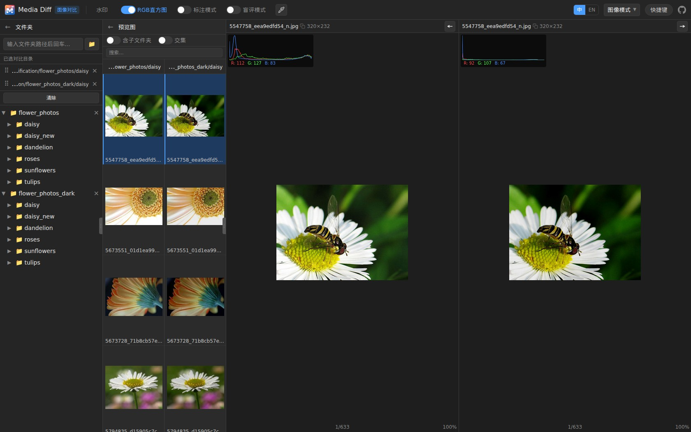
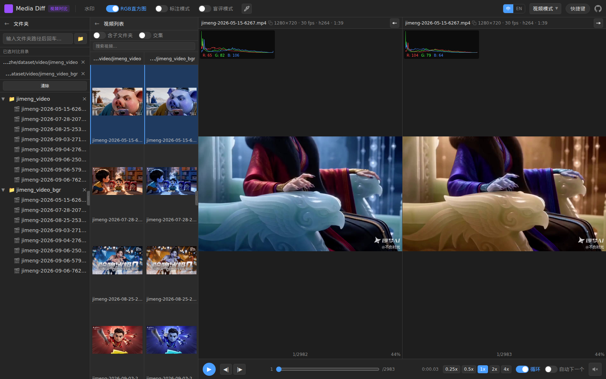

# Media Diff

> 本项目代码全部由 GLM5.2 和 DeepseekV4.1Flash 开发。

本地或远程部署的图片与视频对比 / 标注 / 盲评工具。基于浏览器运行，支持单图/双图/三图/四图查看、同步缩放平移、直方图叠加，视频逐帧对比（播放同步 + 暂停抽帧做图像级精细比较），以及图像 / 视频标注与盲评。

前端构建产物已随 Python 包分发，安装后一条命令即可启动，**无需安装 Node.js**；也可 `--host 0.0.0.0` 部署到服务器供远程访问（见 [远程部署](#远程部署)）。

## 界面预览

图像对比模式（多窗口同步缩放、RGB 直方图叠加、窗口水印、标注、盲评等）：



视频对比模式（多窗口逐帧对比、倍数播放、自动播放下一个视频、RGB 直方图叠加、窗口水印、标注、盲评等）：


## 安装

> 目前尚未发布到 PyPI，请从 git 仓库或本地源码安装。

使用 [uv](https://docs.astral.sh/uv/)（推荐）：

```bash
# 从 git 仓库安装
uv tool install "git+https://github.com/WZMIAOMIAO/media-diff.git"

# 或克隆后从本地源码安装
git clone https://github.com/WZMIAOMIAO/media-diff.git
cd media-diff
uv tool install .
```

或使用 pip：

```bash
pip install "git+https://github.com/WZMIAOMIAO/media-diff.git"
# 或从本地源码
pip install .
```

安装后若提示 `~/.local/bin` 不在 PATH，执行一次：

```bash
uv tool update-shell    # 之后重开终端
```

> 发布到 PyPI 后即可直接使用 `uv tool install media-diff` / `pip install media-diff`。

## 使用

```bash
media-diff
```

默认在 `http://127.0.0.1:8000` 启动服务并自动打开浏览器。常用参数：

| 参数 | 说明 |
|------|------|
| `--host 0.0.0.0` | 监听所有网卡，供局域网访问 |
| `--port 8080` | 指定端口（默认 8000） |
| `--no-browser` | 启动后不自动打开浏览器 |
| `--root PATH` | 限制只能访问 `PATH` 及其子目录，打开目录时默认指向该路径 |
| `--reload` | 代码变更自动重载（开发用） |
| `--extract-concurrency N` | ffmpeg 抽帧并发上限（默认 4） |
| `--transcode-concurrency N` | 视频转码并发上限（默认 1） |
| `--thumbnail-concurrency N` | 视频封面抽帧并发上限（默认 2） |
| `--probe-concurrency N` | 视频元信息探测并发上限（默认 2） |
| `--sync-threads N` | 同步端点（图片缩略图/直方图、文件系统列举等）线程池上限（默认 40） |
| `--version` | 查看版本 |

> **并发参数按用途分开**，也可用环境变量设置：`MEDIA_DIFF_EXTRACT_CONCURRENCY`、`MEDIA_DIFF_TRANSCODE_CONCURRENCY`、`MEDIA_DIFF_THUMBNAIL_CONCURRENCY`、`MEDIA_DIFF_PROBE_CONCURRENCY`、`MEDIA_DIFF_SYNC_THREADS`（CLI 参数优先级更高）。多用户或高核数服务器可适当调大（如 32 核可设抽帧 16、转码 4；192 核可设更高）。所有希望使用同一批视频的用户会共享缓存与转码结果。

> **多用户并发**：图片缩略图/直方图、文件系统列举等同步请求共用一个线程池（`--sync-threads`，默认 40）；视频抽帧/转码/探测则各有独立的 ffmpeg 进程池（见上）。健康检查 `/api/health` 为异步端点，不占用该线程池，因此即便并发很高，`media-diff status` / `stop` 也能正确判断实例状态。并发用户很多时可按需调大 `--sync-threads` 与各 ffmpeg 并发。

### 限制访问目录（沙箱）

默认不限制访问范围，可读取本机任意路径。若部署在共享环境或只想暴露某个数据集，用 `--root` 指定访问根目录：

```bash
media-diff --root /data/dataset
```

- 打开目录（选择文件夹）时**默认指向该根目录**；
- 只允许浏览/读取该目录**及其子目录**，访问根目录以外的路径一律返回 403（符号链接指向外部同样被拦截）；
- 也可用环境变量 `MEDIA_DIFF_ROOT` 设置；`--root` 传入的路径不存在会直接报错退出。

```bash
# 等价写法
MEDIA_DIFF_ROOT=/data/dataset media-diff
```

也可用模块方式启动：`python -m media_diff`。

在前台运行时按 `Ctrl+C` 停止；服务会最多等待 5 秒让浏览器中未完成的连接（如视频流）关闭，随后强制退出，不会卡在 "Shutting down"。

### 查看与停止运行中的服务

```bash
media-diff status            # 列出正在运行的实例（PID / 状态 / 版本 / 启动时间 / 地址）
media-diff status --json     # 以 JSON 输出，便于脚本处理

media-diff stop              # 停止实例（仅一个时）；多个时需指定范围
media-diff stop --port 8000  # 停止监听指定端口的实例
media-diff stop --pid 12345  # 停止指定 PID 的实例
media-diff stop --all        # 停止所有运行中的实例
media-diff stop --force      # 跳过身份校验，强制结束进程
```

`stop` 默认会先做健康检查确认目标确实是 media-diff 服务（防止 PID 被复用误杀），校验不通过会跳过并提示，可用 `--force` 强制结束。

### 清理缓存

非原生格式（mkv/avi/mov/flv 等）播放时会转码为 mp4 缓存到系统临时目录，长期使用可能占用磁盘。可用以下命令清理：

```bash
media-diff clean             # 删除全部转码缓存，并显示释放的空间
media-diff clean --dry-run   # 只统计不删除
```

缓存目录默认在系统临时目录下（Windows 为 `%TEMP%\_video_transcode_cache`），可用环境变量 `MEDIA_DIFF_TRANSCODE_CACHE_DIR` 指定其他位置。

启动时会自动检测：若目标 `host:port` 上已有 media-diff 在运行，会直接打开该地址而不是重复启动；若检测到其他端口的实例，会提示但仍在当前端口启动。

> 实例信息记录在用户状态目录（Linux 为 `~/.local/state/media-diff/`，macOS 为 `~/Library/Application Support/media-diff/`，Windows 为 `%LOCALAPPDATA%\media-diff\`），可用环境变量 `MEDIA_DIFF_STATE_DIR` 覆盖。进程退出后会自动清理；失效条目会在下次读取时按 PID、**进程身份标识（启动时间，可识别 PID 复用）** 与健康检查剔除。

> 视频功能依赖 ffmpeg。它通过 `imageio-ffmpeg` 依赖自动提供，无需系统单独安装；若系统存在 `ffprobe`，探测会使用它，否则自动回退到 `ffmpeg -i` 解析。

### 下载文件夹（打包为 zip）

在目录树里右键文件/文件夹即可「下载」：单个文件直接下载原始字节（非转码版视频）；**文件夹由后端打包成 zip**（保留原目录结构、含隐藏项与空目录），打包进度在页面弹窗显示，下载/暂停续传用浏览器原生下载界面。上限：文件夹条目总数（含子目录）超过 2000 会被拒绝。同目录的并发下载共享同一次打包。

打包默认**不压缩（store）**——图片/视频本身已是压缩格式，deflate 只会慢约 10 倍而体积几乎不变。如需对纯文本目录压缩更小体积，可设环境变量 `MEDIA_DIFF_ZIP_COMPRESSION=deflate`。打包临时文件位于系统临时目录，下载完成后（或从未下载、超过 TTL）会自动清理，无需手动处理。

### 视频请求返回 400

读取某个视频时返回 `400 Bad Request`，表示该文件的处理被拒绝，**与服务器并发无关**（同目录其他视频正常即可排除配置问题）。响应体里的 `detail` 会带上原因，同时在**服务端日志**里也会记录一行 `video processing failed for <路径>: <原因>`。常见原因：

- **不支持的扩展名**：不在支持列表内（见 `VIDEO_EXTENSIONS`）。这类文件也不会出现在视频列表里。
- **编码/封装该服务器的 ffmpeg 不支持**：不同 ffmpeg 构建支持的解码器不同，部分编码（如 HEVC/AV1/ProRes、某些 10bit 或私有编码）可能解码失败。
- **文件损坏/不完整**：如 `moov atom not found`、`Invalid data found when processing input`、`抽帧返回空数据` 等。
- **路径不是普通文件**：如符号链接失效、挂载/权限导致无法 `stat`。

排查：`tail -f` 服务端日志，或用 `curl -i 'http://<host>:<port>/api/videos/info?path=<URL编码后的绝对路径>'` 直接看 `detail`；必要时用同版本 `ffmpeg -i <文件>` 复现。若确认是该服务器的 ffmpeg 缺少对应解码器，可安装系统 ffmpeg 并用 `FFMPEG_BIN` 指定，或换用包含所需解码器的构建。

## 远程部署

部署到远程服务器，供局域网 / 内网多用户通过浏览器访问（前端已随包分发，**无需安装 Node.js**）：

```bash
# 监听所有网卡；建议配合 --root 只暴露数据集目录
media-diff --host 0.0.0.0 --port 8000 --no-browser --root /data/dataset
```

之后访问 `http://<服务器IP>:8000`。

**多用户**：按机器核数调大并发，例如 `--sync-threads 64 --extract-concurrency 16 --transcode-concurrency 4`。

## 技术栈

| 层 | 技术 |
|----|------|
| 前端 | Vite + React 19 + TypeScript + Tailwind CSS v4 + React Router |
| 后端 | Python FastAPI + Pillow + NumPy + imageio-ffmpeg |

## 项目结构

```
media-diff/
├── media_diff/          # Python 包（可安装）
│   ├── cli.py           # media-diff 命令入口（含 status / stop 子命令）
│   ├── registry.py      # 运行实例注册表（status / stop / 启动去重）
│   ├── app.py           # FastAPI 应用 + 前端静态托管 / SPA fallback
│   ├── config.py        # 配置常量
│   ├── routers/         # API 路由（filesystem / images / videos / annotations / blind_eval）
│   ├── utils/           # 工具函数（缓存、图像、视频、文件系统、标注、盲评）
│   └── static/          # 前端构建产物（提交进仓库，随 wheel 分发）
├── frontend/            # 前端源码（仅开发时使用）
│   ├── src/
│   └── vite.config.ts   # 构建输出到 ../media_diff/static
├── tests/               # pytest 测试
├── doc/                 # 设计文档
├── pyproject.toml
└── LICENSE
```

## 开发

### 环境要求

- **Python** >= 3.10（推荐 3.13+）
- **Node.js** >= 18（仅前端开发 / 构建时需要）
- **uv**（推荐）

### 安装依赖

```bash
uv sync --extra test
cd frontend && npm install
```

### 开发模式（前后端分离，支持热更新）

```bash
# 终端 1：后端（http://localhost:8000）
uv run python -m media_diff --reload

# 终端 2：前端（http://localhost:5173，自动代理 /api 到后端）
cd frontend && npm run dev
```

浏览器访问 `http://localhost:5173`。

### 构建前端并集成验证

前端构建产物会直接写入 Python 包内，随后由 FastAPI 单进程托管：

```bash
cd frontend && npm run build      # 输出到 media_diff/static
cd .. && uv run media-diff        # 单端口访问 http://127.0.0.1:8000
```

### 测试与检查

```bash
uv run pytest                     # Python 测试
cd frontend && npm run lint       # oxlint
cd frontend && npm run build      # tsc 类型检查 + 构建
```

### 打包发布

```bash
cd frontend && npm run build      # 先构建前端，产物需一并提交
cd .. && uv build                 # 生成 dist/*.whl 与 sdist
```

## API 概览

| 方法 | 路径 | 说明 |
|------|------|------|
| GET | `/api/health` | 健康检查 |
| GET | `/api/filesystem/roots` | 返回 OS 根目录 |
| GET | `/api/filesystem/home` | 返回默认浏览目录（Linux/macOS 为家目录，Windows 为桌面） |
| POST | `/api/filesystem/browse` | 浏览文件夹（子目录 + 图片 + 视频 + 可选 JSON） |
| POST | `/api/filesystem/images` | 列出文件夹下图片 |
| POST | `/api/filesystem/videos` | 列出文件夹下视频 |
| GET | `/api/images/view` | 查看原图 |
| GET | `/api/images/thumbnail` | 缩略图 + 直方图（`X-Histogram` 响应头） |
| GET | `/api/images/histogram` | RGB 直方图与均值 |
| GET | `/api/videos/info` | 视频信息（帧率、帧数、时长、分辨率） |
| GET | `/api/videos/stream` | 可播放视频流（原生格式直连，其余转码缓存） |
| GET | `/api/videos/frame` | 抽取指定帧 + 直方图 |
| GET | `/api/videos/thumbnail` | 视频封面缩略图 + 直方图 |
| GET | `/api/videos/histogram` | 指定帧直方图 fallback |
| POST | `/api/annotations/check-path` | 校验标注输出路径（目录自动补默认文件名，返回是否已存在/可写） |
| POST | `/api/annotations/load` | 读取标注 JSON |
| POST | `/api/annotations/save` | 追加/替换写入标注（按“文件路径 + 问题”去重，支持 `image`/`video`） |
| POST | `/api/blind-eval/setup` | 盲评初始化（交集、随机分份、每图窗口排列） |
| POST | `/api/blind-eval/vote` | 盲评点赞投票（动态写入结果 JSON） |
| POST | `/api/blind-eval/load` | 读取盲评结果 |
| POST | `/api/blind-eval/save` | 写入盲评结果 |

## 许可证

[MIT](LICENSE)
