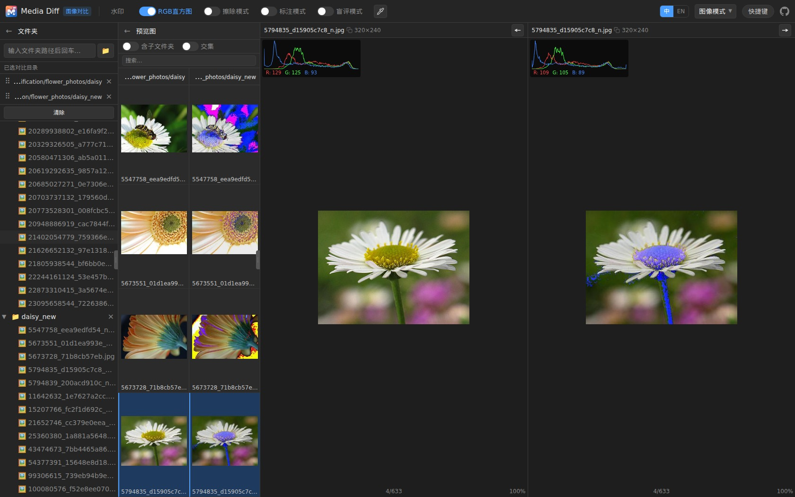
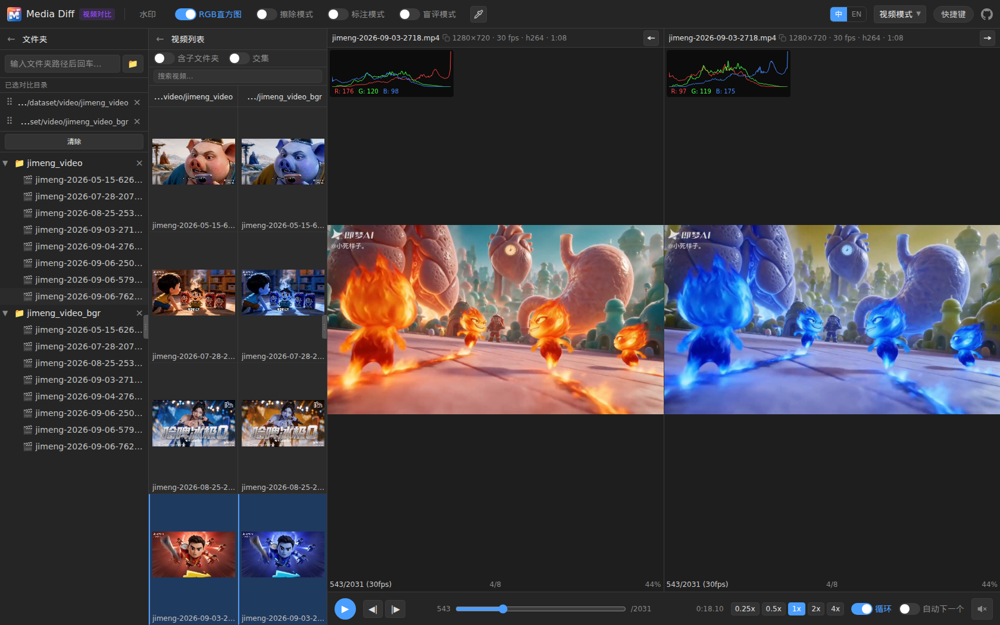

# Media Diff 

English | [简体中文](README.zh-CN.md)

> All code in this project was developed by GLM5.2 and DeepseekV4.1Flash.

A browser-based image and video comparison / annotation / blind-review tool that can be deployed locally or remotely. It supports single, dual, triple, and quad image views, synchronized zoom and pan, histogram overlays, and frame-by-frame video comparison (synchronized playback plus paused-frame extraction for pixel-level inspection).

The frontend build is shipped inside the Python package, so a single command is enough after installation — **Node.js is not required**. You can also deploy it to a server with `--host 0.0.0.0` for remote access (see [Remote deployment](#remote-deployment)).

## Screenshots

Image comparison mode (multi-window synchronized zoom, RGB histograms, window watermarks, annotation, blind review, etc.):



Video comparison mode (multi-window frame-by-frame comparison, speed control, auto-advance, RGB histograms, window watermarks, annotation, blind review, etc.):



## Installation

> This project is not yet published on PyPI. Please install it from the git repository or local source.

Using [uv](https://docs.astral.sh/uv/) (recommended):

```bash
# Install from the git repository
uv tool install "git+https://github.com/WZMIAOMIAO/media-diff.git"

# Or install from local source after cloning
git clone https://github.com/WZMIAOMIAO/media-diff.git
cd media-diff
uv tool install .
```

Or using pip:

```bash
pip install "git+https://github.com/WZMIAOMIAO/media-diff.git"
# Or from local source
pip install .
```

If `~/.local/bin` is not on your PATH after installation, run:

```bash
uv tool update-shell    # reopen the terminal afterwards
```

> Once published to PyPI, you can use `uv tool install media-diff` / `pip install media-diff` directly.

## Usage

```bash
media-diff
```

Starts the server at `http://127.0.0.1:8000` and opens the browser automatically. Common options:

| Option | Description |
|--------|-------------|
| `--host 0.0.0.0` | Listen on all interfaces for LAN access |
| `--port 8080` | Use a custom port (default: 8000) |
| `--no-browser` | Do not open the browser on startup |
| `--root PATH` | Restrict access to `PATH` and its subdirectories; the folder picker starts here |
| `--reload` | Auto-reload on code changes (development only) |
| `--extract-concurrency N` | Max concurrent ffmpeg frame extractions (default: 4) |
| `--transcode-concurrency N` | Max concurrent video transcodes (default: 1) |
| `--thumbnail-concurrency N` | Max concurrent video thumbnail extractions (default: 2) |
| `--probe-concurrency N` | Max concurrent video metadata probes (default: 2) |
| `--sync-threads N` | Thread pool size for synchronous endpoints (image thumbnails/histograms, filesystem listing, etc.; default: 40) |
| `--version` | Print the version |

> **Concurrency options are split by workload** and can also be set with environment variables: `MEDIA_DIFF_EXTRACT_CONCURRENCY`, `MEDIA_DIFF_TRANSCODE_CONCURRENCY`, `MEDIA_DIFF_THUMBNAIL_CONCURRENCY`, `MEDIA_DIFF_PROBE_CONCURRENCY`, and `MEDIA_DIFF_SYNC_THREADS` (CLI options take precedence). Increase them on multi-user or high-core servers (for example, extract 16 / transcode 4 on a 32-core machine, or higher on a 192-core machine). Users who open the same videos share the cache and transcode results.

> **Multi-user concurrency**: synchronous requests such as image thumbnails/histograms and filesystem listings share one thread pool (`--sync-threads`, default 40). Video frame extraction, transcoding, and probing each have their own ffmpeg process pool (see above). The health endpoint `/api/health` is async and does not use that thread pool, so `media-diff status` / `stop` can still detect an instance correctly under heavy load. Increase `--sync-threads` and the ffmpeg concurrency limits as needed for many users.

### Restricting directories (sandbox)

By default any local path can be read. For shared environments or to expose only specific datasets, use `--root` to specify allowed roots (**repeatable**, or separate multiple paths with `os.pathsep`: `:` on Linux/macOS, `;` on Windows):

```bash
# Multiple roots: repeat the option
media-diff --root /data/dataset --root /data/another

# Or separate paths with pathsep in one argument (Linux/macOS)
media-diff --root /data/dataset:/data/another
```

- The folder picker **starts at the first root**; other roots can be entered as absolute paths.
- Only these directories **and their subdirectories** can be browsed/read. Access to anything outside all roots returns 403 (symlinks pointing outside are blocked too).
- The environment variable `MEDIA_DIFF_ROOT` is also supported (multiple paths separated by pathsep). If any `--root` path does not exist, startup fails immediately.

```bash
# Equivalent forms
MEDIA_DIFF_ROOT=/data/dataset media-diff
MEDIA_DIFF_ROOT=/data/dataset:/data/another media-diff   # multiple roots
```

You can also start it as a module: `python -m media_diff`.

Press `Ctrl+C` to stop it in the foreground. The server waits up to 5 seconds for unfinished browser connections (such as video streams) to close, then force-exits without hanging on "Shutting down".

### Check and stop a running instance

```bash
media-diff status            # List running instances (PID / status / version / start time / address)
media-diff status --json     # JSON output for scripts

media-diff stop              # Stop the instance (only when there is one); specify a target when multiple exist
media-diff stop --port 8000  # Stop the instance listening on a port
media-diff stop --pid 12345  # Stop a specific PID
media-diff stop --all        # Stop all running instances
media-diff stop --force      # Skip identity checks and force-kill the process
```

`stop` performs a health check first to confirm the target really is a media-diff server (avoiding PID-reuse mistakes). If verification fails it skips the target and reports it; `--force` overrides this.

### Clean cache

Videos in non-native formats (mkv/avi/mov/flv, etc.) are transcoded to mp4 and cached in the system temporary directory, which may take up disk space over time. Clean it with:

```bash
media-diff clean             # Delete all transcode cache and report reclaimed space
media-diff clean --dry-run   # Only calculate, do not delete
```

The cache directory defaults to the system temp directory (Windows: `%TEMP%\_video_transcode_cache`) and can be changed with `MEDIA_DIFF_TRANSCODE_CACHE_DIR`.

Startup checks automatically: if media-diff is already running at the target `host:port`, it opens that address instead of starting a duplicate; if instances are detected on other ports it prints a notice but still starts on the current port.

> Instance information is stored in the user state directory (Linux: `~/.local/state/media-diff/`, macOS: `~/Library/Application Support/media-diff/`, Windows: `%LOCALAPPDATA%\media-diff\`) and can be overridden with `MEDIA_DIFF_STATE_DIR`. It is cleaned up on exit; stale entries are filtered on the next read by PID, **process identity (start time, which detects PID reuse)**, and health check.

> Video features depend on ffmpeg. It is provided automatically through the `imageio-ffmpeg` dependency, so no separate system installation is required. If `ffprobe` is available, probing uses it; otherwise it falls back to parsing `ffmpeg -i` output.

### Download folders (packed as zip)

Right-click a file or folder in the tree and choose "Download": single files download their original bytes directly (no transcoded video); **folders are packed into a zip by the backend** (preserving the directory structure, including hidden entries and empty directories). Packing progress is shown in a dialog, and download/pause/resume use the browser's native download UI. Limit: folders whose total entry count (including subdirectories) exceeds 2000 are rejected. Concurrent downloads of the same folder share one packing job.

Packing uses **no compression (store)** by default — images and videos are already compressed, and deflate would be about 10x slower with almost no size benefit. For text-only folders, set `MEDIA_DIFF_ZIP_COMPRESSION=deflate`. Temporary zip files live in the system temp directory and are cleaned up after download (or when never downloaded and past their TTL); no manual cleanup is needed.

### Playback vs paused (extracted frame) color mismatch?

The colors of a video **during playback** and **after pausing (extracted frame)** may differ slightly (for example, a pure red video looks orange during playback but pure red when paused). This is **not a problem with the file or this tool**:

- The **paused image** is extracted by the backend with `ffmpeg` and is **color-accurate**, matching system players (such as Windows Media Player) and `ffmpeg`.
- The **playback image** is rendered by the browser's native `<video>`, so its color depends on the browser's decoder (software/hardware GPU), color management, and hardware overlay. This tool cannot control that. In some environments (commonly Chrome/Edge on Windows with hardware acceleration enabled, and SD/BT.601 content with color tags), the browser processes video differently from static images, producing "wrong color during playback, correct when paused".
- This tool **does not modify video bytes or apply any filters** (`/api/videos/stream` returns playable formats unchanged).

If you see this, **disable hardware acceleration** in the browser (Chrome/Edge: Settings → System → turn off "Use graphics acceleration when available", then restart the browser), or try another browser/machine.

## Remote deployment

Deploy to a remote server so multiple users on a LAN/intranet can access it through a browser (the frontend is bundled, **Node.js is not required**):

```bash
# Listen on all interfaces; using --root to expose only the dataset is recommended
media-diff --host 0.0.0.0 --port 8000 --no-browser --root /data/dataset
```

Then visit `http://<server-ip>:8000`.

**Multi-user**: increase concurrency according to CPU cores, for example `--sync-threads 64 --extract-concurrency 16 --transcode-concurrency 4`.

## Tech stack

| Layer | Technology |
|-------|------------|
| Frontend | Vite + React 19 + TypeScript + Tailwind CSS v4 + React Router |
| Backend | Python FastAPI + Pillow + NumPy + imageio-ffmpeg |

## Project structure

```
media-diff/
├── media_diff/          # Python package (installable)
│   ├── cli.py           # media-diff command entry (status / stop subcommands)
│   ├── registry.py      # Running-instance registry (status / stop / startup dedupe)
│   ├── app.py           # FastAPI app + frontend static hosting / SPA fallback
│   ├── config.py        # Configuration constants
│   ├── routers/         # API routes (filesystem / images / videos / annotations / blind_eval)
│   ├── utils/           # Utilities (cache, images, videos, filesystem, annotations, blind review)
│   └── static/          # Frontend build output (committed and shipped in the wheel)
├── frontend/            # Frontend source (development only)
│   ├── src/
│   └── vite.config.ts   # Build output goes to ../media_diff/static
├── tests/               # pytest tests
├── doc/                 # Design documents
├── pyproject.toml
└── LICENSE
```

## Development

### Requirements

- **Python** >= 3.10 (3.13+ recommended)
- **Node.js** >= 18 (only for frontend development / builds)
- **uv** (recommended)

### Install dependencies

```bash
uv sync --extra test
cd frontend && npm install
```

### Development mode (separate frontend/backend with hot reload)

```bash
# Terminal 1: backend (http://localhost:8000)
uv run python -m media_diff --reload

# Terminal 2: frontend (http://localhost:5173, proxies /api to the backend)
cd frontend && npm run dev
```

Open `http://localhost:5173` in the browser.

### Build the frontend and verify the integrated app

The frontend build is written directly into the Python package and served by FastAPI in a single process:

```bash
cd frontend && npm run build      # Output goes to media_diff/static
cd .. && uv run media-diff        # Single-port access at http://127.0.0.1:8000
```

### Tests and checks

```bash
uv run pytest                     # Python tests
cd frontend && npm run lint       # oxlint
cd frontend && npm run build      # tsc type check + build
```

### Packaging and release

```bash
cd frontend && npm run build      # Build the frontend first; commit the output too
cd .. && uv build                 # Produce dist/*.whl and sdist
```

## API overview

| Method | Path | Description |
|--------|------|-------------|
| GET | `/api/health` | Health check |
| GET | `/api/filesystem/roots` | Return OS filesystem roots |
| GET | `/api/filesystem/home` | Return the default browse directory (home on Linux/macOS, Desktop on Windows) |
| POST | `/api/filesystem/browse` | Browse folders (subdirectories + images + videos + optional JSON) |
| POST | `/api/filesystem/images` | List images in a folder |
| POST | `/api/filesystem/videos` | List videos in a folder |
| GET | `/api/images/view` | View an original image |
| GET | `/api/images/thumbnail` | Thumbnail + histogram (`X-Histogram` response header) |
| GET | `/api/images/histogram` | RGB histogram and means |
| GET | `/api/videos/info` | Video metadata (fps, frame count, duration, resolution) |
| GET | `/api/videos/stream` | Playable video stream (native formats direct, others via transcode cache) |
| GET | `/api/videos/frame` | Extract a specific frame + histogram |
| GET | `/api/videos/thumbnail` | Video cover thumbnail + histogram |
| GET | `/api/videos/histogram` | Histogram fallback for a specific frame |
| POST | `/api/annotations/check-path` | Validate annotation output path (adds a default filename for directories; returns exists/writable) |
| POST | `/api/annotations/load` | Load annotation JSON |
| POST | `/api/annotations/save` | Append/replace annotations (deduplicated by file path + question; supports `image`/`video`) |
| POST | `/api/blind-eval/setup` | Initialize blind review (intersection, random parts, per-image window order) |
| POST | `/api/blind-eval/vote` | Submit a blind-review vote (writes results JSON dynamically) |
| POST | `/api/blind-eval/load` | Load blind-review results |
| POST | `/api/blind-eval/save` | Save blind-review results |

## License

[MIT](LICENSE)
